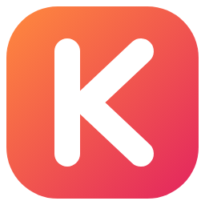

<p align="center"></p>
<h1 align="center">Kolay for YouTube</h1>
<p align="center">A calmer, faster YouTube — plus speed hotkeys for every video on the web.<br>
<a href="https://makolay322.github.io/Better-Youtube/">Website</a> ·
<a href="https://makolay322.github.io/Better-Youtube/privacy.html">Privacy</a> ·
<a href="store/LISTING.md">Store texts</a> ·
<a href="PUBLISHING.md">Publishing guide (TR)</a></p>

A Manifest V3 extension for **Chrome / Edge / Brave / Opera** and **Firefox (140+)**. Everything is configurable from the extension's **Settings** page (settings can be exported/imported as JSON). The interface is available in English, Türkçe, Español, Português, Deutsch, Français, Русский and 日本語 (translations live in `extension/shared/locales/`; `node tools/check-i18n.js` verifies them). No data collection, no network requests.

> Formerly *Better Youtube*. Moving from a manual install to the store version? Export your settings first (Settings → Export) and import them in the new install.

## Install

- **Chrome Web Store / Firefox Add-ons:** links will appear on the [website](https://makolay322.github.io/Better-Youtube/) once the listings are live.

### Manual install

Download the package for your browser from [Releases](https://github.com/makolay322/Better-Youtube/releases) (or build it, see below).

**Chrome / Chromium:** extract `kolay-youtube-<ver>-chrome.zip` into a permanent folder → open `chrome://extensions` → enable **Developer mode** → **Load unpacked** → select the folder. (Chrome rejects `.crx` files that don't come from the Web Store, so unpacked is the only manual option.)

**Firefox:** open `about:debugging#/runtime/this-firefox` → **Load Temporary Add-on…** → pick `kolay-youtube-<ver>-firefox.zip`. Temporary add-ons are removed on restart; for a permanent install use the Firefox Add-ons listing.

> Because the video speed hotkeys work on **all sites**, the browser shows a "read and change data on all sites" warning at install time. The speed script only looks at `<video>` elements and key presses and sends no data anywhere.

### Developing from git

Load the `extension/` folder unpacked. In this mode the extension checks its own `manifest.json` every 15 minutes and reloads itself when the version changes, so a scheduled `git pull` keeps it up to date. (Store builds drop this mechanism and the `alarms` permission; stores update the extension themselves.)

```bash
git clone https://github.com/makolay322/Better-Youtube.git
```

## Build

```bash
./tools/build.sh            # → dist/kolay-youtube-<ver>-{chrome,firefox,source}.zip
./tools/build.sh --unpacked # also extracts to dist/unpacked/{chrome,firefox}
```

`tools/build.py` derives each store manifest from `extension/manifest.json` (Firefox gets `browser_specific_settings` with the add-on ID and data-collection declaration). CI (`.github/workflows/build.yml`) builds and lints with `web-ext` on every push and attaches the zips to a GitHub release when a `v*` tag is pushed.

Icons and store images are generated from `assets/icon.svg` and the screenshots in `docs/img/`:

```bash
node tools/render-icons.js assets/icon.svg <out-dir>   # needs Playwright
node tools/render-store-assets.js
```

The landing page lives in `docs/` (GitHub Pages).

## Features

**Most used** (top of the settings page and the popup)

| Section | What it does |
|---|---|
| Video speed (all sites) | `G` preset speed, `R` 1x, `O` slower, `P` faster (keys and step are configurable). The last speed is remembered browser-wide and applied to every video |
| Video quality | If the chosen quality is unavailable it steps down automatically (4K → 2K → 1080p → …); a high-bitrate (Premium) variant is preferred when available |
| Hiding | Shorts (everywhere) · "Explore new topics" row · surveys / YouTube Playables / other irrelevant elements · repeated videos · Mix · course and podcast playlists · watched videos · ongoing and ended live streams (Subscriptions page only) |

**Other** (lower in the settings)

| Section | What it does |
|---|---|
| Hiding details | Watched-percentage range, upcoming premieres, members-only, duration filter, keyword / channel blocklist, extra shelf titles, dimming, excluded pages |
| Repeat hider details | Pages it applies to, visibility threshold, retention time/count, statistics and reset |
| Playlist cleaner | On a playlist page, click the toolbar icon and press "Clear list"; delays, limit, failure threshold, confirmation |
| Player | Default/remembered volume, captions, disable autoplay, pause when the tab is hidden, pause other tabs, theater mode, expand description |
| Page layout | Hide comments, recommendations, live chat, end cards, cards, watermark, shelves, info panels, ambient mode…; home grid columns; progress bar color |
| Volume keys | Volume up / down |

> YouTube changes its UI often. If something stops working, enable Settings → General → *Debug log* and check the console.

## License

[MIT](LICENSE). Kolay for YouTube is an independent project and is not affiliated with YouTube or Google LLC.
